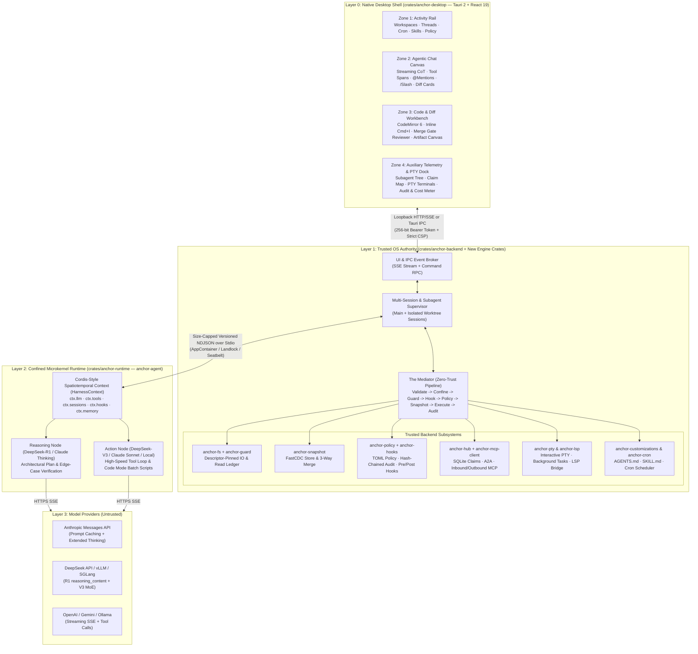
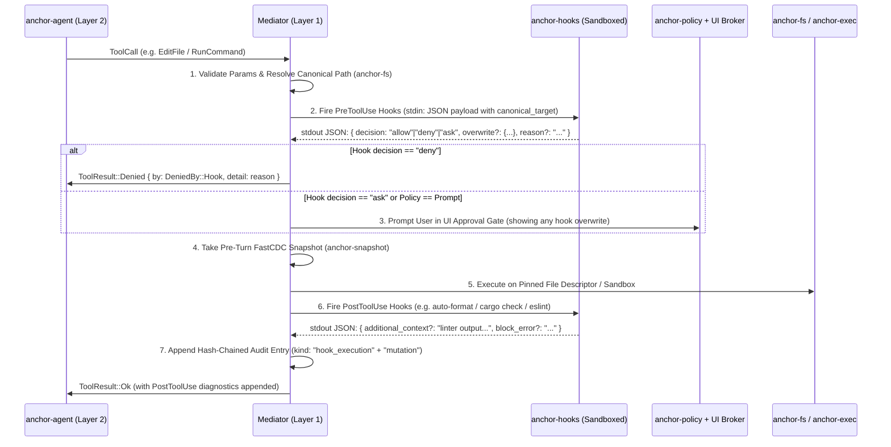

# Anchor Desktop Coding Harness: Complete Architectural & UI/UX Specification

> [!IMPORTANT]
> **Vision Statement:** Upgrade [Anchor](file:///c:/Users/HP/Desktop/Anchor/anchor/README.md) from a single-run CLI harness and read-only post-run collaboration dashboard into a **full-featured, interactive, multi-agent Desktop Coding Harness** (`anchor-desktop` + `anchor-daemon`). It unites the **autonomous execution depth of Claude Code**, the **spatiotemporal plugin microkernel and hybrid reasoning/action routing of DeepSeek Harness (`dsh`)**, and the **unified 4-zone spatial layout of Google Antigravity 2.0 & Antigravity IDE**—built on top of Anchor's zero-trust, descriptor-confined, FastCDC-snapshotted, hash-chained Rust core, with a **Swiss-Industrial precision UI** that rejects every "AI slop" visual trope.

---

## 1. Current Codebase Audit & Gap Matrix

### 1.1 What Anchor Already Has (Phases 1–8)
Anchor’s foundation ([Cargo.toml](file:///c:/Users/HP/Desktop/Anchor/anchor/Cargo.toml)) is an extraordinary 13-crate zero-trust Rust workspace:
* **Three-Layer Authority Separation:**
  * **Layer 1 ([`anchor-backend`](file:///c:/Users/HP/Desktop/Anchor/anchor/crates/anchor-backend/src/lib.rs)):** Sole OS authority via [`Mediator`](file:///c:/Users/HP/Desktop/Anchor/anchor/crates/anchor-backend/src/mediator.rs#L108-L125). Validates parameters, resolves canonical paths via descriptor-pinned [`anchor-fs`](file:///c:/Users/HP/Desktop/Anchor/anchor/crates/anchor-fs/src/lib.rs), enforces [`anchor-guard`](file:///c:/Users/HP/Desktop/Anchor/anchor/crates/anchor-guard/src/lib.rs) (read-before-write ledger & append-only file guards), evaluates TOML rules via [`anchor-policy`](file:///c:/Users/HP/Desktop/Anchor/anchor/crates/anchor-policy/src/policy.rs#L161-L165), snapshots workspaces before mutation via FastCDC content-addressed [`anchor-snapshot`](file:///c:/Users/HP/Desktop/Anchor/anchor/crates/anchor-snapshot/src/lib.rs), runs commands in OS sandboxes ([`anchor-exec`](file:///c:/Users/HP/Desktop/Anchor/anchor/crates/anchor-exec/src/lib.rs) + [`anchor-seccomp`](file:///c:/Users/HP/Desktop/Anchor/anchor/crates/anchor-seccomp/src/lib.rs) / Landlock / Seatbelt / Windows AppContainers), and logs every action to a SHA-256 hash-chained audit log.
  * **Layer 2 ([`anchor-runtime`](file:///c:/Users/HP/Desktop/Anchor/anchor/crates/anchor-runtime/src/agent.rs)):** Unprivileged `anchor-agent` process speaking size-capped NDJSON over stdio ([`anchor-protocol`](file:///c:/Users/HP/Desktop/Anchor/anchor/crates/anchor-protocol/src/messages.rs#L14-L55)), with deterministic constant-time [`Router`](file:///c:/Users/HP/Desktop/Anchor/anchor/crates/anchor-runtime/src/router.rs), [`PrefixMonitor`](file:///c:/Users/HP/Desktop/Anchor/anchor/crates/anchor-runtime/src/prompt.rs#L164-L188) for prompt-cache stability, and [`ContextTracker`](file:///c:/Users/HP/Desktop/Anchor/anchor/crates/anchor-checkpoint/src/lib.rs) with atomic checkpoints.
  * **Layer 3 (Model Providers):** [`provider.rs`](file:///c:/Users/HP/Desktop/Anchor/anchor/crates/anchor-runtime/src/provider.rs) (`OpenAiCompatible` + `MockProvider` + local server port probing).
* **Multi-Agent Coordination & Verification:**
  * [`anchor-hub`](file:///c:/Users/HP/Desktop/Anchor/anchor/crates/anchor-hub/src/lib.rs): SQLite shared state, leased file claims, inter-agent message bus with held-message approvals, decision log, serialized merge queue, MCP `2026-07-28` and A2A `1.0` HTTP endpoints.
  * [`anchor-verify`](file:///c:/Users/HP/Desktop/Anchor/anchor/crates/anchor-verify/src/lib.rs): Deterministic sandboxed test/build/coverage runner, cross-family LLM reviewer, and third-party verifier plugin contract (`verifier.toml`).
* **Current Web UI ([`ui/`](file:///c:/Users/HP/Desktop/Anchor/anchor/ui/src/App.tsx)):**
  * Loopback-served React 19 + TypeScript + Vite inspector with 8 tabs (`Story`, `Messages`, `Claims`, `Decisions`, `MergeQueue`, `Cost`, `Snapshots`, `Audit`), left sidebar (`Approvals`, `Roster`), and a stub [`CommandBar`](file:///c:/Users/HP/Desktop/Anchor/anchor/ui/src/panels/CommandBar.tsx#L16-L90).

### 1.2 Comprehensive Feature & Capability Gap Matrix

| Capability Domain | Source Inspiration | Current Anchor State | What Needs to Be Added |
| :--- | :--- | :--- | :--- |
| **Desktop Shell & Lifecycle** | Antigravity 2.0 ([ADR-0002](file:///c:/Users/HP/Desktop/Anchor/anchor/docs/adr/0002-desktop-shell.md)) | Deferred; browser-only loopback URL (`#t=token`). | Native **Tauri 2** desktop shell (`crates/anchor-desktop`) + persistent multi-workspace session supervisor in `anchor-backend`. |
| **Interactive Multi-Turn Chat & Streaming** | Claude Code, DeepSeek, Antigravity | Single-shot `--task TEXT` CLI runs; non-streaming `ureq` completions; no user follow-ups mid-session. | Streaming token & reasoning deltas (`StreamDelta`), interactive `UserTurn` injection, `@` context mentions, image/media attachments, and `/slash` workflow dispatch. |
| **Microkernel Plugin & Context Architecture** | DeepSeek Harness (`dsh` / Cordis) | Hardcoded loop in [`agent.rs`](file:///c:/Users/HP/Desktop/Anchor/anchor/crates/anchor-runtime/src/agent.rs); static `TOOLS_JSON`. | Spatiotemporal **`HarnessContext` (`ctx.llm`, `ctx.tools`, `ctx.sessions`, `ctx.hooks`, `ctx.memory`)** with reversible scoped plugin mounting/unmounting and append-only trajectory projection (`derive_messages()`). |
| **Hybrid Reasoning (`R1`) + Action (`V3`) Loop** | DeepSeek Harness (`R1` + `V3`), Claude Extended Thinking | Single model per session (`TaskKind::Agentic` or `Review`); no `reasoning_content` parsing; only OpenAI non-streaming adapter. | **Split Planner/Executor Turn Pipeline**: `R1`/Thinking model plans & reasons (`<think>` / `reasoning_content` / Anthropic `thinking` blocks) $\rightarrow$ `V3`/Fast MoE model executes rapid tool loops. Native **Anthropic Messages API**, **DeepSeek**, and **Gemini** streaming adapters. |
| **Deterministic Lifecycle Hooks** | Claude Code Hooks, Antigravity `hooks.json` | None. Only static TOML policy rules. | **`anchor-hooks` crate**: Deterministic execution of `SessionStart`, `UserPromptSubmit`, `PreInvocation`, `PreToolUse` (with `allow`/`deny`/`ask`/`overwrite`), `PostToolUse`, `PostInvocation`, and `Stop` hooks (sandboxed command, HTTP policy webhook, or verifier). |
| **Hierarchical Rules, Skills & Memory** | Claude Code (`CLAUDE.md`), Antigravity (`.agents/`) | Static `SYSTEM_PROMPT` constant in [`prompt.rs`](file:///c:/Users/HP/Desktop/Anchor/anchor/crates/anchor-runtime/src/prompt.rs#L12-L19). | **`anchor-customizations` crate**: Hierarchical directory walk for `ANCHOR.md`, `CLAUDE.md`, `AGENTS.md`, `GEMINI.md` (with `@path` includes & 20k token budget), Progressive Disclosure `SKILL.md` loader, and persistent `MEMORY.md` auto-memory. |
| **Rich Agent Toolset** | Claude Code, DeepSeek Code Mode, Antigravity | 7 basic tools (`read_file`, `write_file`, `edit_file`, `list_dir`, `glob`, `grep`, `run_command`) + Hub/Claims. | Line-range `ReadFile` (`start_line`/`end_line`), `MultiEdit` (atomic multi-hunk replacement), `ApplyPatch`, `NotebookEdit` (`.ipynb`), `TodoWrite` (structured task checklists), `AskQuestion` (interactive UI modal), `WebSearch` & `WebFetch`, `LspQuery` (definitions/references/diagnostics), `InvokeSubagent` (`Explore`, `Plan`, `Verify`, custom `.agents/agents/*.md`), `ScheduleTask` (cron/timers), `WriteArtifact`, and **DeepSeek Code Mode** (sandboxed multi-tool batch script execution). |
| **Outbound MCP Client** | Claude Code MCP, Antigravity `mcp_config.json` | Inbound MCP server only (`POST /mcp` on `anchor-hub`). | **Outbound MCP Client** (`stdio` & Streamable HTTP/SSE) in `anchor-backend` so agents can call external MCP servers (GitHub, Postgres, Sentry, Chrome DevTools) through the [`Mediator`](file:///c:/Users/HP/Desktop/Anchor/anchor/crates/anchor-backend/src/mediator.rs) permission & audit pipeline. |
| **Code Editor, Diff Canvas & PTY Terminal** | Antigravity IDE & 2.0 ([ADR-0008](file:///c:/Users/HP/Desktop/Anchor/anchor/docs/adr/0008-editor.md)) | Deferred. Static `<pre>` diffs in `MergeQueue.tsx`. | **CodeMirror 6** workbench with Tree-sitter & LSP bridge, inline `Cmd+I` instructive edit bar, Code Lenses above symbols, side-by-side/inline red-green visual diff reviewer with per-hunk Accept/Reject, and **Xterm.js + ConPTY/portable-pty** interactive & background task terminals. |

---

## 2. System Architecture Blueprint

### 2.1 High-Level Architecture Diagram



---

## 3. DeepSeek + Claude Code + Antigravity Harness Engine Specification

### 3.1 DeepSeek Microkernel Architecture (`HarnessContext` in `anchor-runtime`)

Currently, [`Session` in `crates/anchor-runtime/src/agent.rs`](file:///c:/Users/HP/Desktop/Anchor/anchor/crates/anchor-runtime/src/agent.rs#L74-L95) is a monolithic struct with a fixed `Vec<ChatMessage>`. Inspired by **DeepSeek Harness (`dsh`)** and its **Cordis** spatiotemporal microkernel, we refactor `anchor-runtime` around a composable, zero-privilege `HarnessContext` (`ctx`) where every capability mounts as a scoped, reversible plugin:

```rust
// crates/anchor-runtime/src/kernel.rs
pub struct HarnessContext {
    /// Unified LLM seam: normalizes streaming text, thinking/reasoning blocks,
    /// prompt cache breakpoints, and token/cost telemetry across vendors.
    pub llm: LlmSeam,
    /// Scoped tool registry: dynamically mounts built-in tools, Hub tools,
    /// outbound MCP tools, and Code Mode batch runners per subagent scope.
    pub tools: ScopedToolRegistry,
    /// Append-only trajectory event log: single source of truth for the session.
    /// Supports time-travel branching, compaction, and pure `derive_messages()`.
    pub sessions: TrajectoryLog,
    /// Runtime hook & prefix-stability interceptors.
    pub interceptors: InterceptorChain,
    /// Scoped memory & progressive-disclosure skill state.
    pub memory: ContextMemory,
}
```

#### Key Microkernel Mechanics:
1. **Spatiotemporal Scoping (`ScopeGuard`):** When the agent enters `/plan` mode, spawns a subagent, or activates a skill (`SKILL.md`), a plugin mounts onto `HarnessContext` and returns a `ScopeId`. When the sub-task finishes or aborts, unmounting `ScopeId` deterministically rolls back temporary system prompt extensions, restricted tool filters (`disallowed_tools`), and ephemeral context items—**without mutating the base prompt prefix** (preserving [`PrefixMonitor`](file:///c:/Users/HP/Desktop/Anchor/anchor/crates/anchor-runtime/src/prompt.rs#L164-L188) KV-cache hits!).
2. **Append-Only Trajectory Log (`ctx.sessions`) & `derive_messages()`:**
   * Instead of mutating `Vec<ChatMessage>` in-place during compaction ([`compact()` in `agent.rs`](file:///c:/Users/HP/Desktop/Anchor/anchor/crates/anchor-runtime/src/agent.rs#L627-L655)), `ctx.sessions` stores an immutable sequence of `TrajectoryNode` entries (`UserPrompt`, `RuleInjection`, `ReasoningSpan`, `AssistantResponse`, `ToolInvocation`, `ToolObservation`, `CompactionSummary`, `HookInjection`, `SubagentReport`).
   * `ctx.sessions.derive_messages(window_budget)` is a **pure function** that projects the active `Vec<ChatMessage>` for the next model call, keeping the prefix byte-identical for KV caching while folding older spans behind verified checkpoint summaries.
   * Supports **Trajectory Forking**: From the UI's Snapshot/Trajectory timeline, a user can click **Branch from Turn $N$** to fork a new conversation thread backed by the exact FastCDC filesystem snapshot and `TrajectoryLog` state at Turn $N$.

---

### 3.2 Hybrid Planner (`R1`) / Executor (`V3`) Routing & Multi-Provider Streaming

DeepSeek Harness demonstrated that pairing a deep reasoning model (**DeepSeek-R1** / **Claude Opus Thinking**) with a fast, low-cost MoE tool-execution model (**DeepSeek-V3** / **Claude Sonnet** / **Qwen-Coder**) yields superior architecture and lower latency.

#### 1. Upgraded [`Router`](file:///c:/Users/HP/Desktop/Anchor/anchor/crates/anchor-runtime/src/router.rs) (`TaskKind` Expansion)
Expand `TaskKind` in [`crates/anchor-runtime/src/router.rs`](file:///c:/Users/HP/Desktop/Anchor/anchor/crates/anchor-runtime/src/router.rs) and `roles.toml`:
* `TaskKind::Planning` (**Planner / Reasoning Node**): Routed to `DeepSeek-R1`, `Claude 4.5/4.6 Opus (Extended Thinking)`, or `Gemini Pro/Next`. Produces structured architectural plans, file claim strategies, and edge-case verification before mutating files.
* `TaskKind::Agentic` (**Action / Tool-Execution Node**): Routed to `DeepSeek-V3`, `Claude Sonnet`, or local `Qwen2.5-Coder`. Executes high-frequency file edits, `MultiEdit` operations, and test loops using the Planner's blueprint injected into context.
* `TaskKind::Explore` (**Fast Subagent Node**): Routed to fast, high-throughput models (`Gemini Flash`, `Claude Haiku`, `DeepSeek-V3`) for read-only `glob`/`grep`/`read_file` codebase reconnaissance.
* `TaskKind::Mechanical` (**Compaction / Commit / Title Node**): Summarizes context windows, formats diffs, and generates semantic commit messages.
* `TaskKind::Review` (**Cross-Family Verification Node**): Existing Anchor guarantee—enforces that `reviewer.family != executor.family` ([ADR-0001](file:///c:/Users/HP/Desktop/Anchor/anchor/docs/adr/0001-launch-model-roster.md)).

#### 2. Native Streaming Provider Adapters (`crates/anchor-runtime/src/provider/`)
Replace the single-file [`provider.rs`](file:///c:/Users/HP/Desktop/Anchor/anchor/crates/anchor-runtime/src/provider.rs) with a modular `provider/` directory supporting **Server-Sent Events (SSE) streaming** over `ureq`:
* **`openai_sse.rs` (OpenAI / vLLM / Ollama / SGLang):** Streams `delta.content` and incremental `delta.tool_calls` fragments.
* **`deepseek.rs` (DeepSeek Native Adapter):**
  * Captures `delta.reasoning_content` (from `deepseek-reasoner` / R1) and `<think>...</think>` tags as first-class `ReasoningDelta` frames on the wire protocol.
  * Supports **DeepSeek Multi-Turn Reasoning Preservation** during tool-call loops and automatic stripping of prior turn `reasoning_content` when switching turns per DeepSeek R1 API specification.
  * Reports `prompt_cache_hit_tokens` and `prompt_cache_miss_tokens` in `Usage` so Anchor’s Cost Meter tracks exact KV-cache savings.
* **`anthropic.rs` (Anthropic Messages API `/v1/messages`):**
  * Native support for `thinking` blocks (`{"type": "thinking", "thinking": "...", "signature": "..."}`) and `redacted_thinking`.
  * Automatic injection of `cache_control: {"type": "ephemeral"}` breakpoints on the system prompt, tool definitions (`TOOLS_JSON`), and the last stable turn boundary—working hand-in-hand with Anchor's [`PrefixMonitor`](file:///c:/Users/HP/Desktop/Anchor/anchor/crates/anchor-runtime/src/prompt.rs#L164-L188).
* **`gemini.rs` (Google Gemini / Vertex Adapter):**
  * Native support for Gemini `thought` parts, context caching, and function declarations.

---

### 3.3 Complete Tool Arsenal (`anchor-protocol` & `anchor-backend`)

Currently, [`ToolRequest` in `crates/anchor-protocol/src/messages.rs`](file:///c:/Users/HP/Desktop/Anchor/anchor/crates/anchor-protocol/src/messages.rs#L142-L189) has 10 variants. To match and surpass **Claude Code**, **DeepSeek Harness**, and **Antigravity**, we expand `ToolRequest` to **22 strictly validated, descriptor-confined tools**:

| # | Tool Variant (`ToolRequest`) | Parameters & Behavior | Backend Security & Guard Enforcement |
| :- | :--- | :--- | :--- |
| 1 | **`ReadFile`** *(Enhanced)* | `path: String`, `start_line: Option<u32>`, `end_line: Option<u32>`. Returns numbered lines (`1: ...`). | Full file read (`start_line == None && end_line == None`) records SHA-256 in `anchor-guard` read ledger. Partial reads record line ranges in a new **Range Read Ledger** so `EditFile` on those exact lines is permitted without full-file read! |
| 2 | **`WriteFile`** *(Existing)* | `path: String`, `content: String`. | Requires `anchor-guard` read-ledger proof (or user deletion-diff approval), edit claim, policy check, and pre-turn FastCDC snapshot. |
| 3 | **`EditFile`** *(Enhanced)* | `path: String`, `edit: EditOp` (`Append`, `Replace { old, new, replace_all: bool }`). | Verifies `old` occurs uniquely (unless `replace_all: true`) and checks `anchor-guard` range/full read ledger. |
| 4 | **`MultiEdit`** *(New — Claude Code)* | `path: String`, `edits: Vec<ReplaceOp>`. Applies multiple non-overlapping replacements to a single file atomically. | Validates all hunks match before writing a single byte; executes as a single atomic descriptor write in `anchor-fs` with one audit entry. |
| 5 | **`ApplyPatch`** *(New — DeepSeek)* | `patch: String` (Unified diff across 1..N files). | Parses diff headers strictly, resolves and confines every path via `anchor-fs`, verifies claims & read ledgers on all targets, snapshots once, and applies all-or-nothing. |
| 6 | **`NotebookEdit`** *(New — Claude Code)* | `path: String`, `cell_id: String`, `op: CellOp` (`Replace`, `Insert`, `Delete`), `cell_type: Option<String>`, `source: String`. | Parses `.ipynb` JSON in backend, preserves cell outputs/metadata unless cleared, enforces read ledger and snapshot. |
| 7 | **`ListDir`** *(Existing)* | `path: String`, `depth: Option<u8>` (1..=5). | Descriptor-confined directory listing with file sizes and git status indicators. |
| 8 | **`Glob`** *(Existing)* | `pattern: String`, `base_dir: Option<String>`. | Validated via `anchor_policy::params::validate_glob`, filtered by policy `readable()`. |
| 9 | **`Grep`** *(Enhanced)* | `pattern: String`, `path_glob: Option<String>`, `context_lines: Option<u8>` (0..=10), `case_insensitive: bool`. | Descriptor-reverified regex search with `before`/`after` context lines and line numbers. |
| 10 | **`LspQuery`** *(New — IDE/Harness)* | `op: LspOp` (`Definition`, `References`, `Hover`, `Symbols`, `Diagnostics`), `path: String`, `line: u32`, `col: u32`. | Queries backend-managed language server (`anchor-lsp`) confined to the workspace—giving the agent compiler-grade symbol navigation without running shell commands. |
| 11 | **`RunCommand`** *(Enhanced)* | `program: String`, `args: Vec<String>`, `cwd_rel: Option<String>`, `network: bool`, `background: bool`, `timeout_ms: Option<u64>`. | Runs in `anchor-exec` sandbox (`Landlock`/`seccomp`/`Seatbelt`/`AppContainer`). If `background: true`, registers a managed background task in `anchor-pty` and wakes the agent reactively on completion. |
| 12 | **`ManageTask`** *(New — Antigravity/Claude)* | `action: TaskAction` (`List`, `Status`, `Logs`, `SendInput`, `Kill`), `task_id: Option<String>`, `input: Option<String>`. | Inspects or controls background commands and timers spawned in this session. |
| 13 | **`CodeModeBatch`** *(New — DeepSeek Code Mode)* | `operations: Vec<BatchOp>` (a deterministic DAG/sequence of read, grep, transform, and edit ops with variable bindings `$1`, `$2`). | Executes multi-step read-search-transform pipelines inside the backend in a single turn without LLM network round-trips, cutting latency and token usage by 60–80%. |
| 14 | **`TodoWrite`** *(New — Claude Code)* | `todos: Vec<TodoItem>` (`id`, `content`, `status: Pending \| InProgress \| Completed \| Blocked`, `priority`). | Updates `Checkpoint.tasks` ([`messages.rs` L575](file:///c:/Users/HP/Desktop/Anchor/anchor/crates/anchor-protocol/src/messages.rs#L575-L590)) and broadcasts live progress to the UI's Task Progress Pill and Auxiliary Pane. |
| 15 | **`AskQuestion`** *(New — Antigravity/Claude)* | `questions: Vec<ClarificationQuestion>` (`question`, `options: Vec<String>`, `multi_select: bool`, `recommended: Option<usize>`). | Pauses the agent via `Broker` (`PendingKind::Question`) and renders an interactive multiple-choice card in the Chat Canvas so the agent never guesses ambiguous requirements. |
| 16 | **`InvokeSubagent`** *(New — Claude/Antigravity)* | `agent_type: String` (`explore`, `plan`, `verify`, `self`, or `.agents/agents/<name>.md`), `role: String`, `prompt: String`, `workspace_mode: WorkspaceMode` (`InheritReadOnly`, `IsolatedWorktree`), `max_turns: Option<u32>`. | Spawns a child `anchor-agent` session supervised by `anchor-backend`. `Explore` runs with read-only tools; `IsolatedWorktree` uses `anchor-snapshot` checkout + Hub claim leases. Wakes parent reactively on completion. |
| 17 | **`SendMessage`** *(New — Antigravity/A2A)* | `recipient: String` (subagent ID, peer agent name, or Hub room), `message: String`. | Routes through `anchor-hub` message bus (respecting `--hold-messages` approval policy). |
| 18 | **`WriteArtifact`** *(New — Antigravity)* | `name: String`, `kind: ArtifactKind` (`Plan`, `Report`, `DiffReview`, `Walkthrough`, `Diagram`), `content: String`, `request_feedback: bool`. | Writes structured Markdown/Mermaid artifacts to `<state_dir>/artifacts/<session_id>/`. If `request_feedback: true`, pauses for user "Proceed / Request Changes" in the UI Artifact Canvas. |
| 19 | **`WebSearch`** & **`WebFetch`** *(New — Claude/Antigravity)* | `query: String`, `domain_filter: Option<String>` / `url: String`, `extract_markdown: bool`. | Enforced by `anchor-policy` `network = true` and `browser_allowlist` domain rules; converts HTML to clean Markdown in the backend, stripping prompt-injection hidden text. |
| 10 | **`McpToolCall`** *(New — Outbound MCP)* | `server: String`, `tool: String`, `args: serde_json::Value`. | Dispatched by `anchor-mcp-client` after passing `PreToolUse` hooks and `anchor-policy` rules (`mcp:<server>:<tool>`). |
| 21 | **`ScheduleTask`** *(New — Antigravity)* | `cron_or_delay: ScheduleSpec`, `prompt: String`, `max_iterations: Option<u32>`. | Persisted in `anchor-cron` SQLite table; visible and manageable in the Left Sidebar's Scheduled Tasks view. |
| 22 | **`ActivateSkill`** *(New — Antigravity/Claude)* | `skill_name: String`. | Loads the full `SKILL.md` body and helper script paths from `.agents/skills/<skill_name>/` into the current `HarnessContext` scope on demand (Progressive Disclosure). |

---

### 3.4 Deterministic Lifecycle Hooks (`crates/anchor-hooks`)

Prompts and `AGENTS.md` files are advisory to the LLM; **Hooks** are deterministic, code-enforced guardrails. We introduce a new crate `crates/anchor-hooks` integrated directly into [`Mediator`](file:///c:/Users/HP/Desktop/Anchor/anchor/crates/anchor-backend/src/mediator.rs) and `session.rs`, supporting both `.anchor/hooks.toml` and `.agents/hooks.json` / `.claude/settings.json` compatibility:



#### Supported Hook Cadences:
1. **`SessionStart`**: Runs when a workspace/conversation opens. Can return `inject_context` (e.g., git branch status, active environment health, custom project banner).
2. **`UserPromptSubmit` / `PreInvocation`**: Runs when the user sends a prompt, before the model is called. Can attach ephemeral reminders or block accidental secret pasting.
3. **`PreToolUse`**: Matches tool name regex (`"run_command|write_file|edit_file"`). Receives canonical paths resolved by `anchor-fs` (preventing path-aliasing bypasses against hooks!). Can return:
   * `decision`: `"allow" | "deny" | "ask" | "force_ask"`
   * `overwrite`: Shallow key-value replacement of tool arguments (audits original + overwritten args and notifies the agent).
4. **`PostToolUse`**: Runs immediately after a tool succeeds or fails (e.g., running `rustfmt` or `ruff` after `EditFile`, or capturing diagnostics).
5. **`PostInvocation` & `Stop`**: Runs when the agent tries to finish (`Done`). If tests are failing, claims are missing, or background tasks are still active, a `Stop` hook can return `{"decision": "continue", "reason": "..."}` to force the agent back into the loop (powering the `/goal` autonomous mode!).

**Security Guarantee:** Unlike other harnesses where hooks run with ambient shell privileges, Anchor executes `command` hooks inside [`anchor-exec`](file:///c:/Users/HP/Desktop/Anchor/anchor/crates/anchor-exec/src/lib.rs) with workspace-scoped confinement, timeout enforcement, and hash-chained audit logging (`DeniedBy::Hook`).

---

### 3.5 Customizations, Rules, Skills & Memory (`crates/anchor-customizations`)

To achieve 100% compatibility with **Claude Code** and **Google Antigravity** workspaces out of the box:
1. **Hierarchical Rule Discovery:**
   * Walks from the active file's directory up to the workspace root, discovering `ANCHOR.md`, `AGENTS.md`, `CLAUDE.md`, `GEMINI.md`, and `.agents/rules/*.md` (plus `.claude/rules/*.md`).
   * Expands `@path/to/file` includes safely through `anchor-fs` (confined to the workspace).
   * Deduplicates by canonical file ID and enforces a **20,000-token aggregate rules budget** (`24 KB` per file cap); over-budget rules are demoted to on-demand file pointers.
   * **Prompt-Prefix Cache Preservation:** Always-on workspace root rules are placed in the static system prefix (monitored by `PrefixMonitor`), while subdirectory-scoped rules triggered mid-session are injected as `<system_reminder>` user-turn blocks so the base prompt prefix hash never invalidates!
2. **Progressive Disclosure Skills (`.agents/skills/<name>/SKILL.md` & `.claude/skills/`):**
   * At session start, only the `name` and `description` from each `SKILL.md` YAML frontmatter (~50 tokens per skill) are listed in the system prompt.
   * When the user types `/skill-name` or the model calls `ActivateSkill { skill_name }`, the full `SKILL.md` instructions and relative paths to `scripts/`, `examples/`, and `references/` are mounted into `HarnessContext`.
3. **Custom Subagent Profiles (`.agents/agents/<name>.md` & `.claude/agents/<name>.md`):**
   * Markdown files with YAML frontmatter (`name`, `description`, `role`, `tools`, `disallowed_tools`, `model_role`, `max_turns`, `workspace_mode`).
4. **Persistent Scoped Memory (`MEMORY.md`):**
   * Stored in Anchor's external state directory (`<state_dir>/memory/MEMORY.md`, [ADR-0022](file:///c:/Users/HP/Desktop/Anchor/anchor/docs/adr/0022-state-dir-outside-workspace.md)) so untrusted workspace scripts cannot tamper with it.
   * Updated via `/learn` or the `MemoryWrite` tool (with user confirmation or diff badge in the UI).

---

## 4. Anti-AI-Slop UI/UX Design System ("Swiss-Industrial Precision")

> [!CAUTION]
> **Strict Anti-AI-Slop Mandate:**
> The UI must **NEVER** use:
> 1. Neon purple-to-cyan gradients, glowing violet borders, or cosmic/nebula backgrounds.
> 2. Generic "sparkle" (`✨`), magic wand, or robot-head icons.
> 3. Floating glassmorphic cards with `backdrop-filter: blur(20px)`, `border-radius: 24px`, and diffuse drop shadows (`box-shadow: 0 20px 50px rgba(...)`).
> 4. Marketing-style hero banners, centered chat landing pages with cheesy greeting text ("How can I help you build today? ✨"), or oversized padded bubbles that waste 40% of vertical screen space.
> 5. Unstructured walls of markdown text mixed with raw JSON dumps.

### 4.1 Design Ethos: Swiss-Industrial Engineering Instrument
Think **Teenage Engineering + Linear + Bloomberg Terminal + Braun (Dieter Rams) + Zed + Antigravity 2.0**:
* **Structural Hairlines (`1px solid`)**: Layout zones are separated by crisp `1px` structural grid lines—no floating cards with wasted margin gaps between panels.
* **High Information Density with Zero Clutter**: Every pixel serves provenance, verification, or code navigation. Bookkeeping is collapsed into single-line expandable telemetry strips; failures, diffs, and approval gates command immediate visual hierarchy.
* **Tactile Cryptographic Provenance**: Because Anchor's superpower is cryptographic trust (SHA-256 audit chains, FastCDC snapshot hashes, descriptor-pinned paths, cross-family verdicts), the UI surfaces short content hashes (`sha256:8f3a…`), canonical path badges, and verification seals like precision hardware indicators.

### 4.2 Color Palette (OKLCH Engineered Dark & Daylight Themes)

All colors are defined in CSS custom properties in `ui/src/styles/tokens.css`. Dark mode uses **Deep Carbon Obsidian** (neutral-warm slate, zero blue-purple tint); Light mode uses **Drafting Paper Alabaster**.

| Token | Dark Mode (` Carbon Obsidian `) | Light Mode (` Drafting Paper `) | Usage |
| :--- | :--- | :--- | :--- |
| `--bg-canvas` | `#0A0B0D` | `#F6F5F2` | Base application background / recessed wells |
| `--bg-surface-1` | `#111317` | `#FFFFFF` | Primary panels (Chat Canvas, Editor, Sidebar) |
| `--bg-surface-2` | `#171A20` | `#EFECE6` | Elevated interactive rows, code blocks, hover states |
| `--bg-surface-3` | `#1E222A` | `#E5E0D8` | Active tab headers, inline diff gutters, modal surfaces |
| `--border-hairline` | `#232730` | `#DCD7CE` | 1px structural grid dividers between zones |
| `--border-focus` | `#3B4252` | `#A8A29E` | Active input / focused pane border |
| `--fg-primary` | `#ECEFF4` | `#141619` | Primary body copy, code symbols, headings |
| `--fg-secondary` | `#949BA6` | `#525866` | Secondary labels, file paths, tool summaries |
| `--fg-muted` | `#5E6572` | `#848B98` | Timestamps, sequence numbers (`#0042`), SHA prefixes |
| `--accent-primary` | `#E06C3A` *(International Signal Orange)* | `#C84B18` | Primary interactive CTA, active indicator bar, cursor |
| `--accent-plan` | `#38BDF8` *(Blueprint Cyan)* | `#0284C7` | Planning mode, `R1` reasoning spans, read claims |
| `--status-ok` | `#2ECC71` (bg: `#0B2416`) | `#15803D` (bg: `#DCFCE7`) | Verified merge, intact hash chain, passing test |
| `--status-warn` | `#F59E0B` (bg: `#291A04`) | `#B45309` (bg: `#FEF3C7`) | Pending approval gate, held message, context >80% |
| `--status-danger` | `#EF4444` (bg: `#2A0B0E`) | `#B91C1C` (bg: `#FEE2E2`) | Refused claim, broken audit chain, failed test, policy deny |

### 4.3 Typography & Scannable Hierarchy
* **UI & Prose (`--font-sans`):** `'Inter'`, `-apple-system`, `'Segoe UI'`, sans-serif. Set with `font-feature-settings: "cv02", "cv03", "cv04", "cv11"`.
* **Code, Paths, Hashes, Metrics (`--font-mono`):** `'JetBrains Mono'`, `'Geist Mono'`, `'Cascadia Code'`, monospace. **Always** set `font-variant-numeric: tabular-nums` on every counter, token tally, cost figure, line number, and timestamp so columns never jitter during live streaming.
* **Type Scale (Strict 4px Baseline Grid):**
  * `11px` (`0.6875rem`, uppercase, `letter-spacing: 0.06em`, `font-weight: 600`): Panel section headers, status badges, keyboard shortcut caps.
  * `12px` (`0.75rem`, mono): File paths, tool call headers, audit sequence numbers, token/cost telemetry.
  * `13.5px` (`0.84375rem`, line-height `1.5`): Primary chat prose, editor code font size, diff lines.
  * `15px` (`0.9375rem`, `font-weight: 600`): Conversation titles, artifact headings.

---

## 5. Spatial Layout Architecture (Antigravity 2.0 + IDE Hybrid)

The application window is divided into **4 resizable structural zones** plus a **28px Top Telemetry Bar** and a **24px Bottom Cryptographic Status Bar**, separated by `1px solid var(--border-hairline)` splitters with drag handles (`react-resizable-panels` or zero-dependency pointer-capture CSS grid splitters to honor Anchor's minimal-dependency philosophy).

```
┌──────────────────────────────────────────────────────────────────────────────────────────────────────────────────┐
│ [⚓ ANCHOR]  ws: /Users/dev/anchor [main*] │ Mode: [⚡ Agent ▾] │ Planner: R1 · Exec: V3 │ 🔒 Chain: #418 OK │ $0.0412 │
├──────────────┬───────────────────────────────────────────────┬───────────────────────────────────────────────────┤
│ ZONE 1       │ ZONE 2: AGENTIC CHAT & TRAJECTORY CANVAS      │ ZONE 3: WORKBENCH & ARTIFACT / DIFF CANVAS        │
│ LEFT SIDEBAR │ (Primary Collaborative Thread)                │ (Contextual Code, Diffs, Plans, Merge Evidence)   │
│ (220px)      │                                               │                                                   │
│              │  ┌─────────────────────────────────────────┐  │  [📄 calc.py] [🔀 Merge #2 Diff] [📐 Plan.md]     │
│ [+ New Task] │  │ USER                          11:02:14  │  │  ┌─────────────────────────────────────────────┐  │
│              │  │ Refactor binary_search in @search.py    │  │  │ 14 │ def binary_search(xs, target):         │  │
│ ▾ WORKSPACES │  │ and verify boundary conditions.         │  │  │ 15 │ -   hi = len(xs) - 1                   │  │
│  ● anchor    │  └─────────────────────────────────────────┘  │  │ 16 │ +   hi = len(xs)                       │  │
│  ○ api-srv   │                                               │  │    │ [Accept Hunk] [Reject] [Ask Reviewer]  │  │
│              │  ▸ 🧠 Reasoning (DeepSeek-R1 · 4.2s · 610 tok)│  └─────────────────────────────────────────────┘  │
│ ▾ THREADS    │  ▸ 📖 ReadFile  src/search.py (L1-84)     ✔   │                                                   │
│  ● Binary..  │  ▸ 🔍 LspQuery  References(binary_search) ✔   │───────────────────────────────────────────────────│
│  ○ Fix TLS   │  ▾ ✏️ EditFile  src/search.py (+6 / -3)   ✔   │ ZONE 4: AUXILIARY TELEMETRY & PTY DOCK            │
│              │    ├─ Guard: Full read verified (sha:9a2f)    │ [Agents (3)] [Claims] [Tasks & PTY (2)] [Snapshots]│
│ ▾ SCHEDULED  │    └─ Snapshot: turns/0004 (0.4ms) [Diff ↗]   │  ┌─────────────────────────────────────────────┐  │
│  ⏱ Nightly   │                                               │  │ ● alpha (V3 · executor)  THINKING  turn 4   │  │
│              │  ┌─ ⚠️ APPROVAL GATE (Rule: run_test) ─────┐  │  │   └─ subagent: explore-tests (Flash) DONE   │  │
│ ▾ CUSTOMIZE  │  │ RunCommand: pytest -q tests/            │  │  │ ● beta  (Claude · tests) WAITING   claim ok │  │
│  📜 Rules(3) │  │ Sandbox: AppContainer · Net: OFF        │  │  │ ● verifier (R1 · review) IDLE      diff fam │  │
│  🛠 Skills(7)│  │ [Approve (Enter)] [Always for pytest] [Deny]│  └─────────────────────────────────────────────┘  │
│  🔌 MCP (4)  │  └─────────────────────────────────────────┘  │  $ pytest -q tests/test_search.py  [SANDBOXED]    │
│  🪝 Hooks(2) │                                               │  .... 12 passed in 0.18s                          │
│              │  ┌─────────────────────────────────────────┐  │                                                   │
│ ▾ SECURITY   │  │ @mention  /command  [📎] [Plan|Auto|Ask]│  │                                                   │
│  🛡 Policy   │  │ Describe a task or type / for commands… │  │                                                   │
│  ⚙ Settings  │  └─────────────────────────────────────────┘  │                                                   │
├──────────────┴───────────────────────────────────────────────┴───────────────────────────────────────────────────┤
│ 🟢 SANDBOX: AppContainer+Job  │  📸 SNAPSHOT: #0019 (FastCDC)  │  🧠 CTX: 18.4k / 128k (14%)  │  🪝 HOOKS: 2 ON  │
└──────────────────────────────────────────────────────────────────────────────────────────────────────────────────┘
```

### 5.1 Zone 1: Left Navigation Sidebar (Antigravity 2.0 Surface)
Collapsible (`Cmd+B` / `Ctrl+B`, `220px` expanded, `44px` icon rail collapsed):
1. **New Conversation / Team Run Button (`Cmd+N`)**: Opens single-agent interactive session or multi-agent `team.toml` run.
2. **Projects & Workspaces Switcher**: Lists opened repositories with live status indicators (idle, agent thinking, approval waiting) and branch/worktree badges.
3. **Conversation Threads**: Searchable history of active and past sessions in the workspace, showing checkpoint count, turn count, and total cost.
4. **Scheduled Tasks (`/schedule`)**: Manage recurring cron jobs and one-shot delayed agent tasks (`anchor-cron`).
5. **Skills & Customizations Drawer**:
   * **Rules**: Inspect active `ANCHOR.md` / `AGENTS.md` / `CLAUDE.md` files, token budget usage (`4.2k / 20k tokens`), and scope paths.
   * **Skills**: Browse `.agents/skills/` with one-click toggle and `SKILL.md` viewer.
   * **MCP Servers**: Status indicators (Connected/Error/Stopped) and tool lists for inbound `anchor-hub` MCP and outbound MCP clients.
   * **Hooks**: Live toggle and execution counters for `PreToolUse` / `PostToolUse` / `Stop` hooks.
6. **Policy & Security Settings**: Visual editor for `policy.toml` (Tool Execution Policy, Sandbox Mode, Non-Workspace Access, Network Egress, Command Allowlist/Denylist, Model Roster & Family matrix).

### 5.2 Zone 2: Agentic Chat & Trajectory Canvas
The central narrative and command surface, replacing generic chat bubbles with **Structured Engineering Trajectory Blocks**:
1. **Collapsible Reasoning Spans (`<ReasoningBlock />`)**:
   * Streams `DeepSeek-R1` / `Claude Extended Thinking` tokens in real time inside a left-bordered (`2px solid var(--accent-plan)`) monospace-accented drawer.
   * Header shows: `🧠 Reasoning · DeepSeek-R1 · 3.8s · 540 tokens`. Auto-collapses once tool execution begins; click to expand and inspect the full chain-of-thought.
2. **Compact Tool Call Spans (`<ToolCallSpan />`)**:
   * Every tool call renders as a single scannable `28px` row by default:
     `[✔] EditFile  crates/anchor-runtime/src/agent.rs  (+24 -6)  [sha256:4b1e… → 9f0a…]  [turn #4]  [View Diff ↗]`
   * Clicking expands the inline unified diff or command output, plus the **Security Provenance Strip**: Canonical Path, Guard Basis (`FullRead` / `RangeRead` / `AppendOnly`), Policy Rule matched, and Pre-Turn Snapshot ID.
3. **Inline Approval Gate Cards (`<InlineApprovalCard />`)**:
   * Instead of hiding approvals only in a side column, pending approvals appear **both** pinned at the bottom of the active trajectory and in the Top/Right Attention Queue:
   * Displays the **Canonical Target Path** (guaranteed by `anchor-fs`), the exact **Policy Rule** or **Guard Reason** (e.g., `guard:unread_overwrite` with deletion diff), **Sandbox Confinement Badge**, and keyboard-driven buttons:
     * <kbd>Enter</kbd> / `Approve Once`
     * <kbd>Shift+Enter</kbd> / `Allow Rule for Session`
     * <kbd>Esc</kbd> / `Deny (with optional feedback to agent)`
4. **Interactive Clarification Cards (`<AskQuestionCard />`)**:
   * When the agent calls `AskQuestion`, renders selectable radio/checkbox options + a custom write-in input directly in the stream.
5. **Rich Multi-Modal Composer (`<Composer />`)**:
   * **Context Pill Bar**: Shows attached `@file`, `@folder`, `@symbol`, `@terminal`, `@thread`, `@rule`, and pasted/dropped images.
   * **Autocomplete Popovers**:
     * Typing `@` queries `anchor-fs` and `anchor-lsp` for instant fuzzy file, directory, symbol, and Hub agent mentions.
     * Typing `/` opens the **Slash Command Palette** (`/plan`, `/implement`, `/review`, `/team`, `/compact`, `/rollback`, `/goal`, `/grill-me`, `/boost`, `/learn`, `/schedule`, `/verify`, `/agents`, `/cost`).
   * **Execution Mode Selector Pill**: Switch seamlessly between:
     * **`Plan Mode`** (Read-only tools + `R1` Planner; produces an interactive Plan Artifact).
     * **`Supervised Mode`** (Default Anchor policy: prompts on mutations/commands per `policy.toml`).
     * **`Sandbox Auto Mode`** (Auto-approves workspace writes & sandboxed test commands; still blocks non-workspace, network, and protected test edits).
     * **`Team Mode`** (Multi-agent parallel execution in isolated snapshot worktrees with cross-family merge verification).

### 5.3 Zone 3: Code, Diff & Artifact Workbench (Antigravity IDE + Merge Gate)
Contextual right-center split pane that opens automatically when inspecting files, reviewing plans, or auditing merges:
1. **CodeMirror 6 Editor (`<CodeWorkbench />`)**:
   * Opens any workspace file with Tree-sitter syntax highlighting and `anchor-lsp` hover/definition support.
   * **Claim Color Gutter**: A `3px` vertical bar in the line-number gutter shows which agent holds an active `edit` or `read` claim on the file, plus lock icons on `append-only` or `protected test` files.
   * **Inline Code Lenses**: Above functions/structs (`Explain`, `Write Unit Test`, `Verify Invariants`, `Claim & Refactor`).
   * **Instructive Inline Edit (`Cmd+I` / `Ctrl+I`)**: Highlight lines and press `Cmd+I` to open a compact inline prompt bar that dispatches a localized `EditFile` task with range-read guard pre-authorization.
2. **Interactive Diff & Merge Evidence Reviewer (`<DiffEvidenceWorkbench />`)**:
   * Upgrades [`MergeQueue.tsx`](file:///c:/Users/HP/Desktop/Anchor/anchor/ui/src/panels/MergeQueue.tsx) into a split-screen **Change vs. Empirical Proof** workstation:
     * **Left Half**: Side-by-side or unified diff with syntax highlighting, line-level **coverage heatbars** (green bar = line executed during verification tests; red stripe = changed line never executed!), and per-hunk `Accept` / `Reject` / `Comment` controls.
     * **Right Half**: The Executor's **Claims** mapped 1-to-1 against **Test Outcomes**, **Sandboxed Command Logs** (hash-verified), **Verifier Plugin Findings**, and the **Cross-Family Reviewer's Verdicts** (`supported` / `refuted` / `unverifiable`).
3. **Artifact Canvas (`<ArtifactViewer />`)**:
   * Renders structured Markdown artifacts (`Plan`, `Architecture Diagram` via Mermaid, `Bug Report`, `Evaluation Matrix`) created via `WriteArtifact`.
   * Includes inline paragraph commenting (highlight any step in a Plan artifact to add a revision note) and a primary **`Proceed with Plan`** button that transitions the session from `Plan Mode` (`R1`) to `Execution Mode` (`V3`).

### 5.4 Zone 4: Auxiliary Telemetry, Subagents & PTY Dock (Antigravity 2.0 Aux Pane)
A multi-tabbed bottom/right dock (`Cmd+J` to toggle) unifying Anchor's existing 8 panels with Antigravity 2.0's runtime monitors:
1. **Subagents & Team Roster (`<AgentTreePanel />`)**:
   * Live hierarchical tree showing the primary agent, spawned subagents (`Explore`, `Plan`, custom), and peer Hub agents (`alpha`, `beta`, `reviewer`).
   * Displays live status (`THINKING`, `WAITING ON APPROVAL`, `VERIFYING`, `DONE`), model family badge, active file claims, context window meter, and a **`Message Agent`** input to steer any running subagent mid-flight.
2. **Files Changed & Claim Map (`<ClaimMapPanel />`)**:
   * Interactive workspace file tree colored by agent ownership, showing `+added / -deleted` line counts for the current session, red badges on refused claim attempts, and one-click diff preview.
3. **Interactive Terminals & Background Tasks (`<TerminalDock />`)**:
   * **User PTY Tabs**: Full `xterm.js` terminal connected to `anchor-pty`.
   * **Agent Command & Sandbox Stream**: Live stdout/stderr stream of `RunCommand` and `[verify]` gate processes, with a one-click **`Attach to Chat (@terminal)`** button for failing build logs.
4. **Snapshot & Trajectory Time-Machine (`<SnapshotTimelinePanel />`)**:
   * Visual DAG of FastCDC pre-turn snapshots, checkpoints, and merge commits.
   * Hover any node to see changed files; click **`Preview Rollback`** (2-step nonce confirmation) or **`Fork Thread Here`**.
5. **Cryptographic Audit & Cost Ledger (`<AuditCostPanel />`)**:
   * Real-time SHA-256 chain verifier status, searchable JSONL audit inspector, and recomputed vs. reported **Cost Meter** broken down by agent, role (`Planner` vs `Executor` vs `Reviewer`), model family, and prompt-cache hit rate.

---

## 6. Wire Protocol & Backend API Additions

### 6.1 `anchor-protocol` Extensions ([`crates/anchor-protocol/src/messages.rs`](file:///c:/Users/HP/Desktop/Anchor/anchor/crates/anchor-protocol/src/messages.rs))

Add the following variants to `Message` (maintaining strict `Validate` bounds and `deny_unknown_fields`):

```rust
// ---- runtime -> backend (Streaming & Rich Agent Events) ----
/// Real-time token or reasoning stream chunk from the active provider.
StreamDelta(StreamDelta),
/// Updated internal task checklist (from TodoWrite).
TodoUpdate(Vec<TaskState>),
/// Request to spawn a child subagent session.
SubagentSpawn(SubagentSpawnRequest),
/// Request to write or update a structured artifact.
ArtifactWrite(ArtifactPayload),
/// Request to ask the user a structured multiple-choice question.
QuestionPrompt(QuestionPromptRequest),

// ---- backend -> runtime (Interactive & Reactive Wakeups) ----
/// New user message or @mention injected into an active interactive session.
UserTurn(UserTurnPayload),
/// Reactive wakeup when a background command, subagent, or cron timer completes.
AsyncNotification(AsyncNotificationPayload),
/// Answer to QuestionPrompt.
QuestionAnswer(QuestionAnswerPayload),
/// User feedback on a Plan/Artifact ("Proceed" or revision comments).
ArtifactFeedback(ArtifactFeedbackPayload),
```

```rust
#[derive(Debug, Clone, PartialEq, Serialize, Deserialize)]
#[serde(deny_unknown_fields)]
pub struct StreamDelta {
    pub turn: u64,
    pub kind: DeltaKind, // Text | Reasoning | ToolCallArgs { call_id: String, name: String }
    pub text: String,
}
```

### 6.2 `anchor-backend` HTTP / SSE / Tauri Bridge Endpoints ([`crates/anchor-backend/src/ui/mod.rs`](file:///c:/Users/HP/Desktop/Anchor/anchor/crates/anchor-backend/src/ui/mod.rs))

Extend the existing hardened HTTP service (and bind directly as Tauri commands in `anchor-desktop`):

| Method & Path | Purpose | Security & Audit |
| :--- | :--- | :--- |
| `GET /api/stream` | **SSE / Chunked Event Stream** (replaces 150ms sleep polling when supported, with `/api/events` fallback). Streams `AuditEvent`, `StreamDelta`, `PtyOutput`, and `ApprovalPending` in `<5ms`. | Bearer token + `Sec-Fetch-Site: same-origin` |
| `POST /api/sessions/start` | Start a new interactive single-agent or team session from the UI (`workspace`, `mode`, `roles_path`, `initial_prompt`, `attachments`). | Audited as `ui_session_start` |
| `POST /api/sessions/:id/prompt` | Send a follow-up user prompt, `/slash` command, or `@mention` context bundle to a running or idle session. | Audited as `ui_user_turn` |
| `POST /api/sessions/:id/interrupt` | Gracefully interrupt the current turn (`SIGINT` to active sandbox command, preserve pre-turn snapshot). | Audited as `ui_interrupt` |
| `POST /api/sessions/:id/fork` | Fork a new session from `checkpoint_id` + `snapshot_ref`. | Audited as `ui_session_fork` |
| `GET /api/fs/tree` & `GET /api/fs/read` | Descriptor-confined file tree and file content reader for the CodeMirror 6 workbench. | Read-only via `anchor-fs::Workspace` |
| `POST /api/fs/inline-edit` | Execute a localized `Cmd+I` inline edit or manual save from the CodeMirror 6 editor (takes a `manual/editor` FastCDC snapshot first!). | Audited as `user_edit` + snapshotted |
| `GET /api/customizations` | List discovered `ANCHOR.md`/`CLAUDE.md`/`AGENTS.md` rules, `SKILL.md` skills, `hooks.json` hooks, and MCP servers with token counts. | Read-only inspection |
| `POST /api/customizations/toggle` | Enable/disable a skill, plugin, hook, or policy rule. | Audited as `ui_config_change` |
| `POST /api/pty/spawn` & `/api/pty/input` | Manage interactive user PTY terminals in the bottom dock. | Explicit user authority only |

---

## 7. New & Modified Crate Map

To keep Anchor's compile times fast and its security boundary auditable ([`deny.toml`](file:///c:/Users/HP/Desktop/Anchor/anchor/deny.toml)), we organize the additions cleanly across the workspace:

### 7.1 New Crates to Add under `crates/`
1. **`crates/anchor-hooks`**:
   * Parses `.anchor/hooks.toml`, `.agents/hooks.json`, and `.claude/settings.json` (`hooks` block).
   * Executes `SessionStart`, `PreInvocation`, `PreToolUse`, `PostToolUse`, `PostInvocation`, and `Stop` hooks inside `anchor-exec` sandboxes with strict JSON stdin/stdout validation and timeout enforcement.
2. **`crates/anchor-customizations`**:
   * Hierarchical rule resolver (`ANCHOR.md`, `AGENTS.md`, `CLAUDE.md`, `GEMINI.md`), `@file` include expander, 20k-token budget manager, Progressive Disclosure `SKILL.md` loader, `.agents/agents/*.md` subagent parser, and `<state_dir>/memory/MEMORY.md` manager.
3. **`crates/anchor-mcp-client`**:
   * Outbound MCP `2026-07-28` client supporting both local `stdio` child servers (sandboxed via `anchor-exec`) and loopback/remote Streamable HTTP servers. Exposes external tools into `Mediator` under `mcp__<server>__<tool>` namespaces.
4. **`crates/anchor-lsp`** *(Optional / Feature-Gated)*:
   * Lightweight JSON-RPC 2.0 stdio supervisor for language servers (`rust-analyzer`, `pyright`, `tsserver`), serving `LspQuery` tool requests to agents and diagnostics/hover to the CodeMirror 6 UI.
5. **`crates/anchor-desktop`**:
   * **Tauri 2** native shell ([ADR-0002](file:///c:/Users/HP/Desktop/Anchor/anchor/docs/adr/0002-desktop-shell.md)). Links `anchor-backend` directly as a Rust library, opens native OS folder pickers for switching workspaces, manages system tray / notifications on approval gates, and embeds the `ui/dist` bundle with strict CSP.

### 7.2 Existing Crates to Upgrade
* **[`crates/anchor-protocol`](file:///c:/Users/HP/Desktop/Anchor/anchor/crates/anchor-protocol/src/messages.rs)**: Add the 12 new `ToolRequest` variants, `StreamDelta`, `UserTurn`, `AsyncNotification`, `QuestionPrompt`, and `ArtifactWrite`.
* **[`crates/anchor-guard`](file:///c:/Users/HP/Desktop/Anchor/anchor/crates/anchor-guard/src/lib.rs)**: Add `RangeReadLedger` so line-bounded `ReadFile { start_line, end_line }` authorizes localized `EditFile` / `MultiEdit` operations on those lines without forcing a 10,000-line full file read.
* **[`crates/anchor-runtime`](file:///c:/Users/HP/Desktop/Anchor/anchor/crates/anchor-runtime/src/lib.rs)**:
  * Add `kernel.rs` (`HarnessContext` with `ctx.llm`, `ctx.tools`, `ctx.sessions`, `ctx.memory`).
  * Add `provider/anthropic.rs`, `provider/deepseek.rs`, `provider/openai_sse.rs`, `provider/gemini.rs`.
  * Upgrade `router.rs` to support `TaskKind::Planning` (`R1`) $\rightarrow$ `TaskKind::Agentic` (`V3`) handoff and `TaskKind::Explore`.
* **[`crates/anchor-backend`](file:///c:/Users/HP/Desktop/Anchor/anchor/crates/anchor-backend/src/lib.rs)**:
  * Upgrade `mediator.rs` to handle `MultiEdit`, `ApplyPatch`, `NotebookEdit`, `CodeModeBatch`, `WebSearch`/`WebFetch`, `LspQuery`, `McpToolCall`, and `PreToolUse`/`PostToolUse` hook execution.
  * Upgrade `session.rs` into an interactive multi-turn `SessionSupervisor` capable of spawning child subagents (`InvokeSubagent`) and streaming `StreamDelta` events to the UI.

### 7.3 Frontend Rewrite Map (`ui/src/`)
```text
ui/src/
├── main.tsx
├── App.tsx                           # 4-Zone Resizable Shell + Top/Bottom Bars + Keyboard Shortcut Router
├── api/
│   ├── client.ts                     # Bearer-authenticated REST + SSE live stream client
│   └── types.ts                      # Complete TypeScript definitions for Trajectory, Diffs, Hooks, Skills
├── styles/
│   ├── tokens.css                    # Swiss-Industrial OKLCH palette, 4px grid, tabular-nums typography
│   ├── layout.css                    # 4-zone hairline grid, splitters, status bars
│   └── components.css                # Trajectory spans, diff viewers, editor, terminal dock
├── zones/
│   ├── TopTelemetryBar.tsx           # Workspace, Mode Pill, R1/V3 Router badge, Hash Chain Seal, Cost
│   ├── LeftSidebar/
│   │   ├── Sidebar.tsx               # Workspaces, Threads, Scheduled Tasks, Customizations, Policy
│   │   ├── CustomizationsDrawer.tsx  # Rules budget bar, SKILL.md browser, MCP servers, Hooks toggles
│   │   └── PolicyEditorModal.tsx     # Visual + TOML editor for policy.toml & roles.toml
│   ├── ChatCanvas/
│   │   ├── ChatCanvas.tsx            # Interactive multi-turn trajectory view
│   │   ├── ReasoningBlock.tsx        # Collapsible streaming R1 / Claude Thinking drawer
│   │   ├── ToolCallSpan.tsx          # 28px scannable tool row with expandable diff & provenance strip
│   │   ├── InlineApprovalCard.tsx    # Canonical path, guard reason, deletion diff, Enter/Esc actions
│   │   ├── AskQuestionCard.tsx       # Multi-choice clarification widget
│   │   └── Composer.tsx              # @mention popover, /slash menu, Mode Pill, image dropzone
│   ├── Workbench/
│   │   ├── Workbench.tsx             # Tabbed container for Editor, Merge Gate Diff, and Artifacts
│   │   ├── CodeEditor.tsx            # CodeMirror 6 + claim gutter + Cmd+I inline edit bar
│   │   ├── MergeEvidenceReviewer.tsx # Side-by-side Diff + Line Coverage Heatbar + Claims & Verdicts
│   │   └── ArtifactCanvas.tsx        # Markdown + Mermaid renderer with "Proceed with Plan" action
│   ├── AuxDock/
│   │   ├── AuxDock.tsx               # Bottom/Right dock container
│   │   ├── AgentTreePanel.tsx        # Main + Subagents + Hub Team Roster + Live Steer input
│   │   ├── ClaimMapPanel.tsx         # Colored file tree + conflict inspector
│   │   ├── TerminalDock.tsx          # xterm.js PTY + Sandboxed Command logs + @terminal attach
│   │   ├── SnapshotTimelinePanel.tsx # FastCDC DAG + 2-step Rollback + Thread Forking
│   │   └── AuditCostPanel.tsx        # Hash-chain verifier, JSONL query, R1/V3/Cache Cost Meter
│   └── BottomStatusBar.tsx           # Sandbox tier, Latest Snapshot ID, Context Window %, Active Hooks
```

---

## 8. Phased Implementation Roadmap

### Phase A: UI/UX Transformation & 4-Zone Antigravity Workbench (`ui/` + `anchor-backend/src/ui`)
1. Implement the **Swiss-Industrial Design System** (`tokens.css`, `layout.css`, `components.css`) and 4-Zone Resizable Shell (`LeftSidebar`, `ChatCanvas`, `Workbench`, `AuxDock`, `TopTelemetryBar`, `BottomStatusBar`).
2. Add `/api/stream` (SSE real-time push), `/api/fs/tree`, `/api/fs/read`, `/api/sessions/start`, and `/api/sessions/:id/prompt` to `anchor-backend/src/ui/mod.rs`.
3. Build the interactive **Chat & Trajectory Canvas** with `ReasoningBlock`, `ToolCallSpan` (with cryptographic provenance strips), `InlineApprovalCard`, and the rich `Composer` (`@` mentions, `/` slash palette, Mode selector).
4. Build the **Workbench** with the upgraded Side-by-Side Diff + Coverage Heatbar + Claim Verdict Reviewer, Code Inspector with inline `Cmd+I`, and Plan Artifact Canvas.

### Phase B: DeepSeek Microkernel (`HarnessContext`), Streaming Providers (`R1`+`V3`), & Rich Toolset
1. Refactor `anchor-runtime` around `HarnessContext` (`ctx.llm`, `ctx.tools`, `ctx.sessions`, `ctx.memory`) with `derive_messages()` and reversible `ScopeGuard` plugins.
2. Add streaming SSE adapters for **DeepSeek (`R1` `reasoning_content` + `V3`)**, **Anthropic Messages API (`thinking` + `cache_control`)**, and **OpenAI/Ollama SSE**, streaming `StreamDelta` frames over `anchor-protocol`.
3. Implement the expanded toolset in `anchor-protocol`, `anchor-guard` (`RangeReadLedger`), and `anchor-backend/src/mediator.rs`: line-range `ReadFile`, `MultiEdit`, `ApplyPatch`, `TodoWrite`, `AskQuestion`, `InvokeSubagent`, `WriteArtifact`, and `CodeModeBatch`.

### Phase C: Deterministic Hooks (`anchor-hooks`), Customizations (`anchor-customizations`), & Outbound MCP
1. Create `crates/anchor-hooks` (`PreToolUse`, `PostToolUse`, `SessionStart`, `PreInvocation`, `Stop`) and wire it into `Mediator::handle()` and `session.rs`.
2. Create `crates/anchor-customizations` for hierarchical `ANCHOR.md` / `CLAUDE.md` / `AGENTS.md` loading, `SKILL.md` progressive disclosure, `.agents/agents/*.md` custom subagents, and `<state_dir>/memory/MEMORY.md`.
3. Create `crates/anchor-mcp-client` and `crates/anchor-desktop` (Tauri 2 native wrapper).
4. Run full workspace test suite (`cargo test --workspace`, `cargo clippy`, Playwright E2E UI verification).
