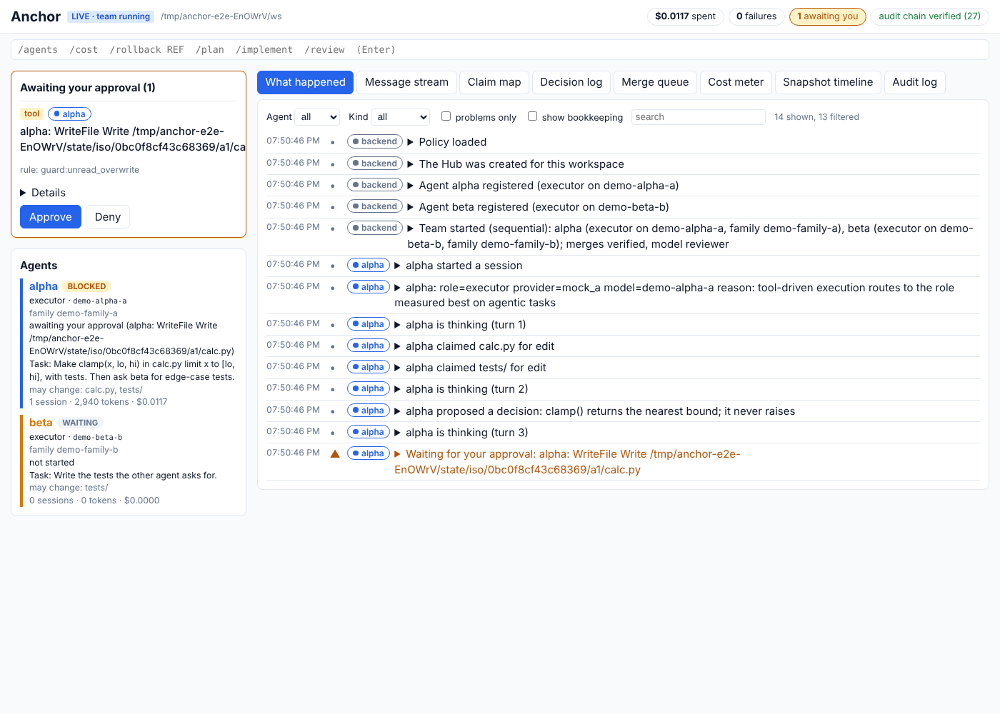
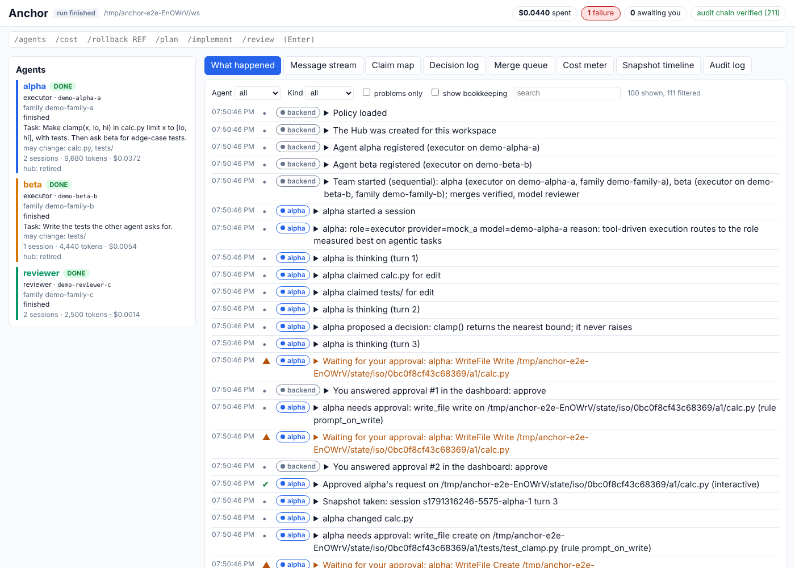
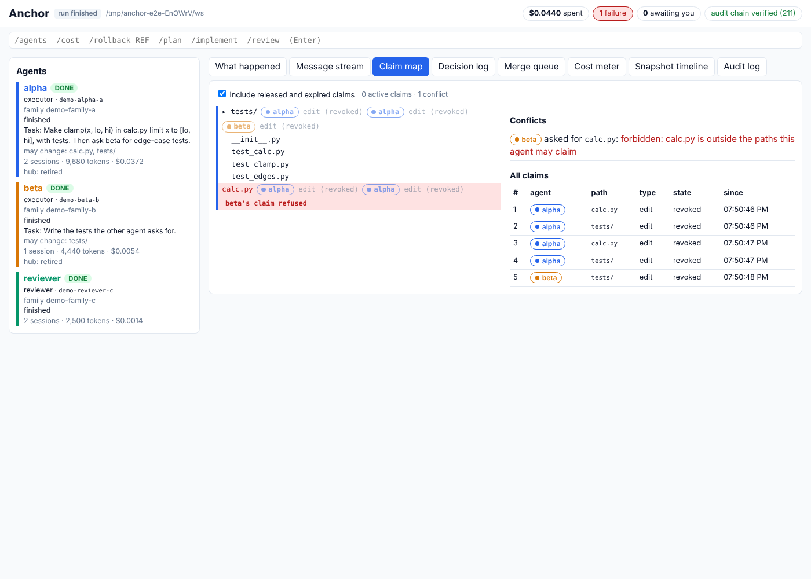
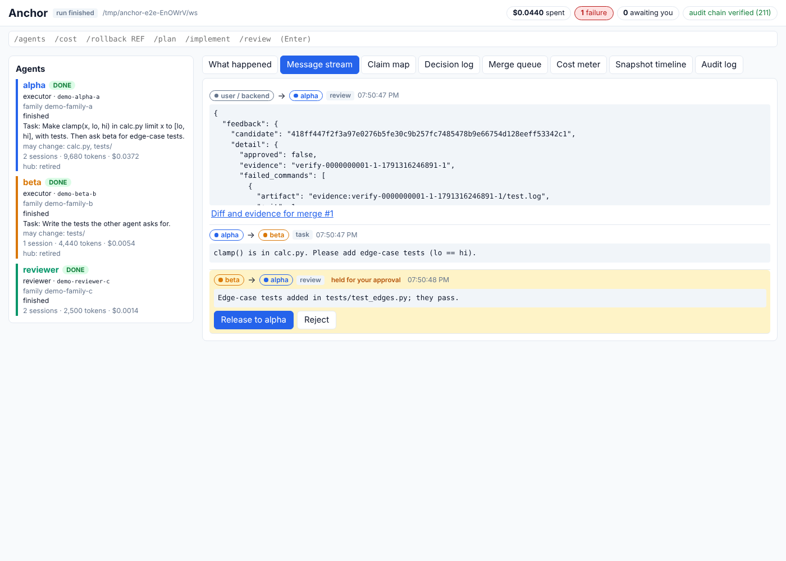
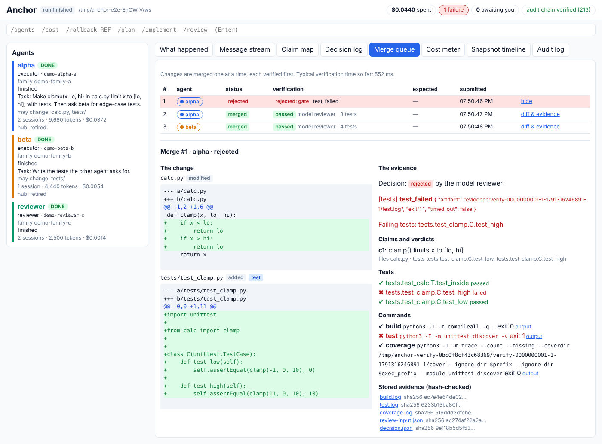
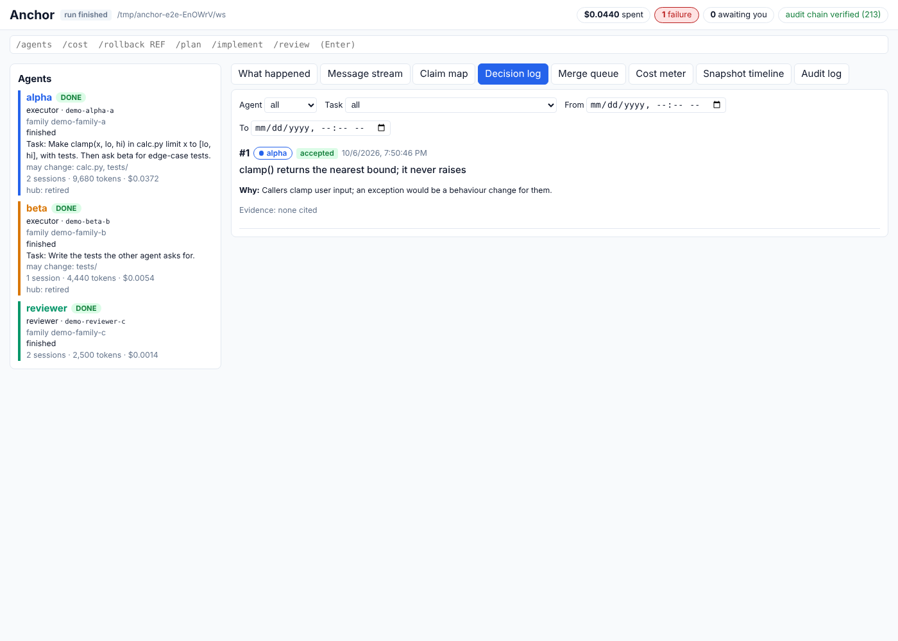
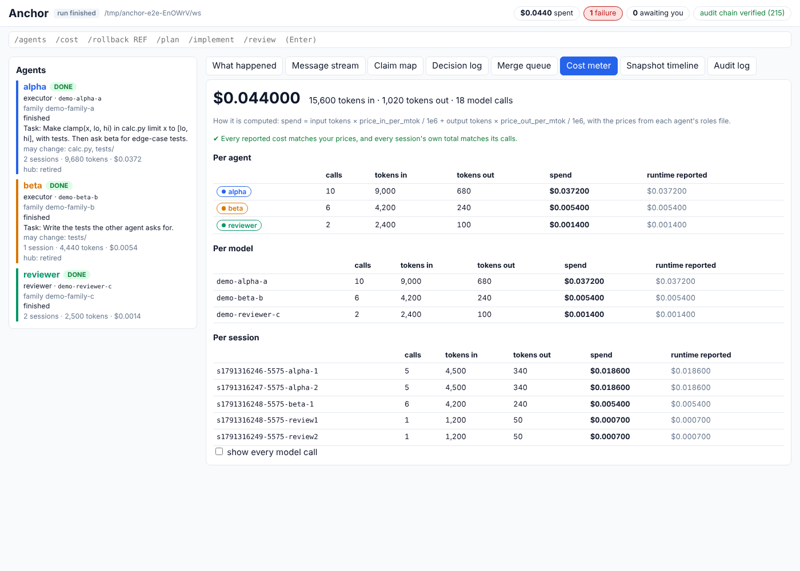
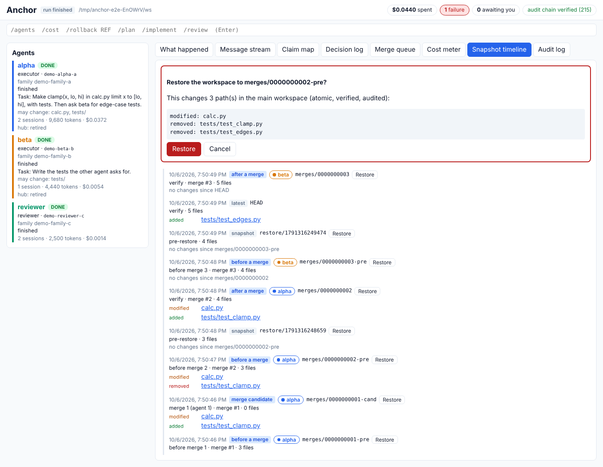

# Dashboard walkthrough

Spec §14 Phase 6 is done when "a user unfamiliar with the tool can watch a
two-model collaboration and understand what happened from the UI alone".
This walkthrough is how that criterion is checked. The screenshots come
from the end-to-end test (`ui/e2e/dashboard.spec.ts`), which drives the
scripted run in [`examples/ui`](../examples/ui/README.md) through the
browser only.

## The tour

**1. Approval gates.** Every prompt the backend would ask on a terminal
appears in the left column, and the agent waiting on it shows
**blocked**:

- a write to a file the agent has not read;
- a merge into the main workspace;
- a context-limit choice.

Each answer is recorded as yours, and in the audit log.

**2. What happened.** The run in order, one sentence per audited event.
Bookkeeping is folded away (tick "show bookkeeping" to see it), but
failures never are. Each line expands to show the exact audit entry.

**3. Claim map.** The workspace tree, colored by the agent that claimed
each part. beta's refused attempt to claim `calc.py` is red.

**4. Message stream.** Messages between the agents. beta's report waits
for you ("held"); release or reject it.

**5. Merge queue: the change and the evidence, side by side.** Merge #1
was rejected. On the left is the diff. On the right:

- the failing test, `test_high`;
- the commands and their stored, hash-checked output;
- the claim and the reviewer's verdict.

**6. Decision log.** alpha's design decision with its rationale; accept
or reject it. You can filter by agent, task and time.

**7. Cost meter.** Tokens and spend per agent, per model and per
session, with the project total. Every call is recomputed from the prices
in your roles files. The meter says when everything agrees, and lists
any mismatch in red.

**8. Snapshot timeline.** Every snapshot, which agent or merge produced
it, and what changed in it. Restore shows what it would change, then asks
you to confirm.

## The check

The automated part of the check is the end-to-end test. It asserts that
the story tells this sequence, in order:

1. the team starts;
2. alpha works, claims `calc.py`, and proposes a decision;
3. merge #1 is rejected for a failing test;
4. alpha gets another attempt;
5. merge #2 passes verification by a reviewer of another model family and
   is applied;
6. beta's claim on `calc.py` is refused;
7. merge #3 is applied.

It also checks the red conflict, the held message, the evidence and the
exact cost.

The human part: someone who has not used Anchor watches the run with
this dashboard and answers, from the UI alone:

1. Which models took part, and in what roles?
2. Why was alpha's first change not merged, and what proved it?
3. What did beta try that it was not allowed to do?
4. What did the run cost, per model?
5. How would you undo merge #2?

| Date | Who | All five answered from the UI? | Notes |
|---|---|---|---|
| *pending* | | | |
